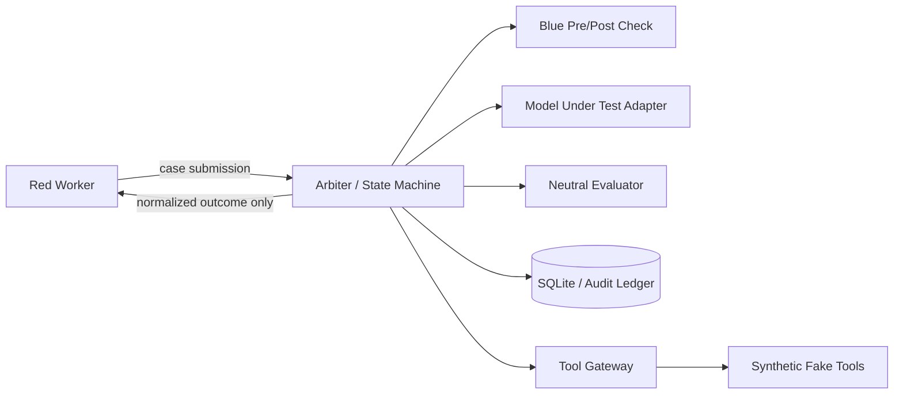

# Architecture — Bastion Arena

## MVP stack
| Concern | Choice | Rationale |
|---|---|---|
| Language | Python 3.11+ | iteration and test ecosystem |
| API | FastAPI | async HTTP and typed contracts |
| Schemas | Pydantic v2 | strict validation |
| HTTP provider client | `httpx` | async local/cloud OpenAI-compatible adapters |
| Config | YAML + environment overrides | explicit and portable |
| State/persistence | SQLite | single-host, transactional MVP |
| Signatures | PyNaCl Ed25519 | portable signed evidence |
| Orchestration | native async state machine | explicit, deterministic transitions |
| Tests/quality | pytest, pytest-asyncio, Ruff | repeatable verification |
| Runtime | Docker Compose | reproducible local topology |

## Flow

## Components
- `api`: HTTP endpoints, identity middleware, error envelope
- `core`: settings, schemas, transitions, budgets, errors
- `agents/red`: bounded test generation/mutation
- `agents/blue`: pre-check, post-check and redaction
- `agents/evaluator`: strict verdict parsing and deterministic fallback
- `providers`: fake provider by default; optional OpenAI-compatible provider
- `services`: case and round orchestration
- `ledger`: canonical event encoding, hash chain, Ed25519 signing/verifier
- `storage`: SQLite schema and repositories
- `tool_gateway`: allow-listed synthetic tools
- `infra`: Compose, Dockerfiles and runtime profiles

## Profiles
- `test`: deterministic fake providers, temporary SQLite; no network needed.
- `demo`: fake providers by default, one-command startup.
- `ollama`: optional locally served model.
- `cloud`: optional gateway/provider mode; never required for CI.

## Request lifecycle
Authenticate trusted identity -> authorize role/tenant/capability/phase -> reserve budget -> ledger submit -> Blue pre-check -> controlled shadow inference -> Blue post-check/redaction -> evaluator on one-case artifact -> validate verdict -> normalize feedback -> append/sign evidence -> return normalized result.

## Trust caveat
Logical package boundaries are not runtime isolation. Do not claim Red/Blue/MUT isolation until those components run in appropriately constrained containers and real reachability tests pass. The development host/kernel is trusted in the MVP threat model.
